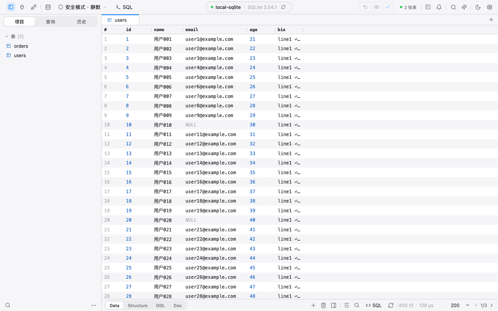
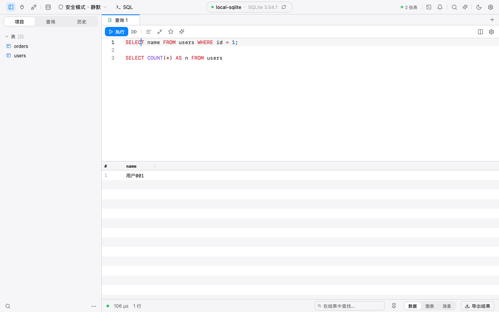
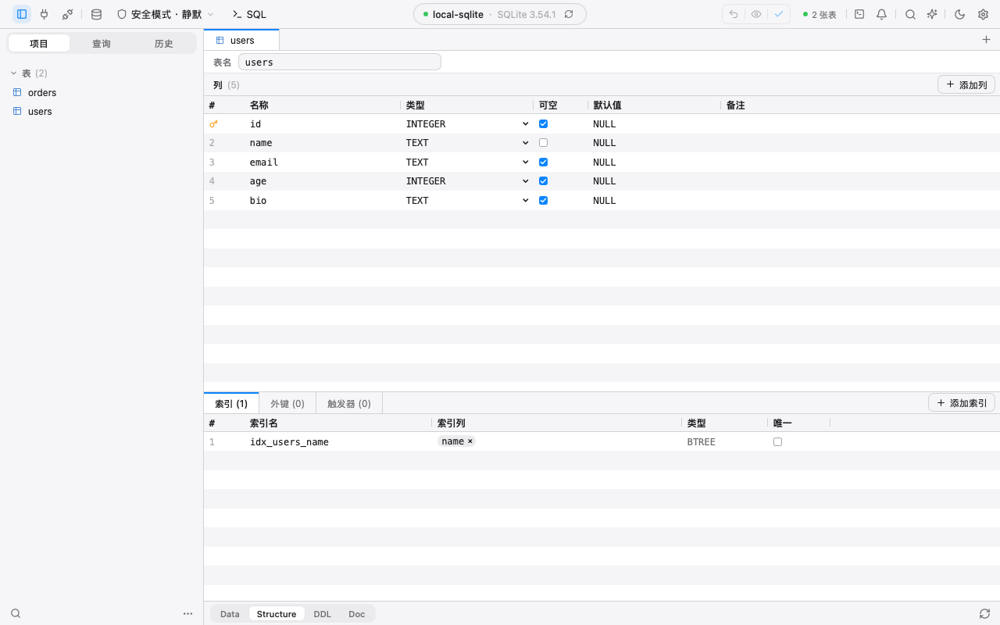
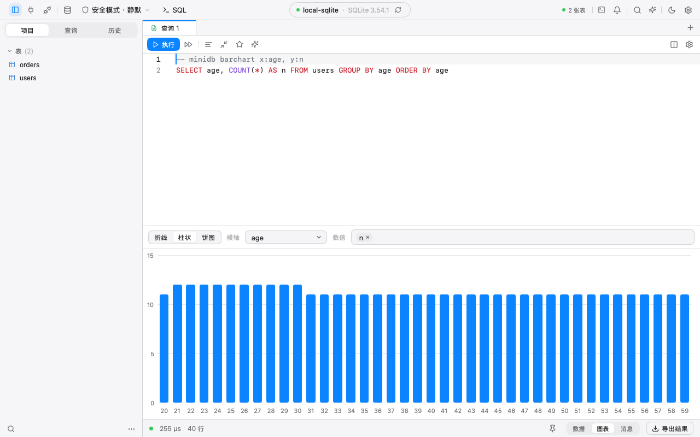
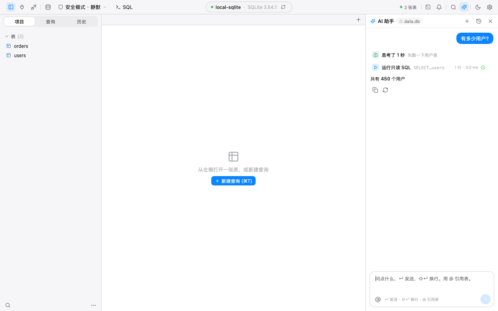
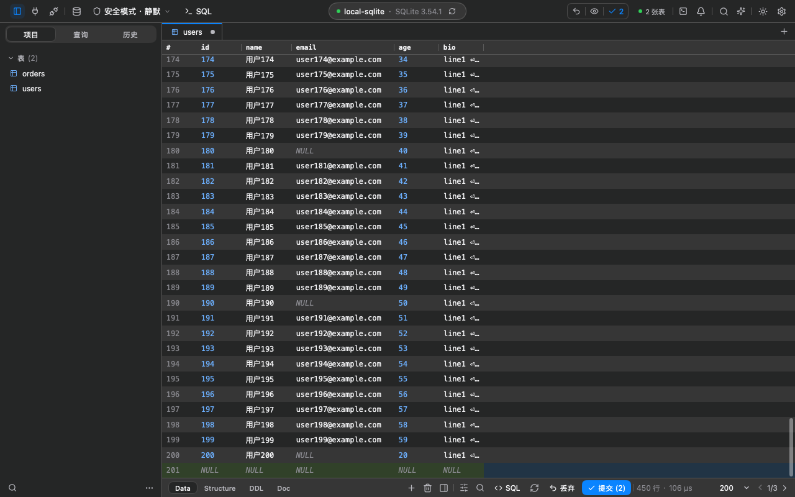

# MiniDB

MiniDB is an AI-assisted desktop database client written in Go with [MyGo](https://mygo.run/)'s native UI: no webview, no frontend toolchain, one small binary. The interface keeps the compact, TablePlus-like macOS look.

**Language:** [简体中文](README.zh-CN.md) | English



## Screenshots

The screenshots show the Chinese UI with demo data; the interface also ships in English.

| | |
| --- | --- |
| <br>**SQL editor**: highlighting, completion, multiple result sets | <br>**Structure**: columns, indexes, foreign keys and triggers in one view |
| <br>**Charts**: turn a result set into a line, bar or pie chart | <br>**AI assistant**: tool timeline and read-only queries |
| <br>**Dark mode**: pending edits are highlighted until you commit | |

## Features

- **Connections**: MySQL, PostgreSQL, SQLite, TiDB, StarRocks; SSH tunnels, read-only mode, environment tags and colors (the accent follows the current connection), encrypted backup and import.
- **Browse and edit**: database/table sidebar, paged data grid with server-side sort and filter (column conditions or raw SQL), block selection copied as TSV / CSV / JSON / SQL INSERT / Markdown; double-click to edit, add and delete rows, preview the exact SQL before it runs, commit in one transaction. The grid remembers each table's column widths, order, hidden and pinned columns; ⌘L jumps to a column by fuzzy name; JSON values open as a tree; BLOBs show as a hex dump you can edit or load from a file.
- **ER diagram**: draws a database's tables and foreign keys as a relationship graph, with layered layout, pan and zoom, draggable tables whose positions are remembered; large databases start with the selected table and its neighbours.
- **SQL editor**: syntax highlighting, table/column/alias completion, run current / selection / all, cancellable, multiple result sets shown as tabs, formatting, history and favorites (⌘D). Results can also be shown as a line, bar or pie chart. **Inline AI** (⌘J) writes or rewrites SQL right in the editor. **Explain** (⌥⌘E) shows the execution plan of the statement under the caret as a tree (PostgreSQL, MySQL, TiDB, SQLite; raw text for StarRocks), with an opt-in ANALYZE that really runs a read-only SELECT and highlights the slowest step.
- **Structure**: a TablePlus-style grid for columns (edit in place, drag rows to reorder on MySQL-family databases) and, below a draggable divider, indexes / foreign keys / triggers. Indexes are added in place as a new row; a DDL preview shows what a commit will run. DDL view; Markdown table docs (AI can draft them).
- **AI assistant**: OpenAI-compatible APIs; streaming answers, a tool timeline (schema, sample rows, read-only SQL, explain plans…), structured results shown as tables; type `@` to mention tables (shown as chips and weighted in the prompt); guardrails allow only a single read-only statement; chats are saved.
- **Import / export**: streaming CSV / JSON / SQL INSERT export, CSV / TSV / JSON / Excel (.xlsx, with sheet picker) import with column mapping, progress and cancel.
- **More**: command palette (⌘P), database switcher (⌘K), process list, Chinese and English, light/dark, session restore (tabs and query drafts), auto update.

Requires macOS 12 or later (Apple Silicon and Intel).

## Development

Go 1.27+ is all you need: no Node, pnpm or cgo.

```bash
go tool mygo dev            # development mode, rebuilds on Go changes
go test ./...               # tests (the UI runs windowless through ui.Tester)
go tool mygo build          # build/darwin-<arch>/MiniDB.app and .dmg
```

Screenshots in `docs/screenshots/` come from the windowless UI tests: run `MINIDB_SHOTS=<dir> go test ./internal/ui/` to render all screens as PNG into `<dir>`.

After editing `locales/*.json`, run `go tool mygo generate` to regenerate the message functions and `go tool mygo i18n check` to compare the two languages.

### Layout

```text
main.go            startup: logging, single instance, store, wiring
mygo.json          app config (name, identifier, version, i18n, macOS)
locales/           zh-Hans.json, en.json and the generated catalog_gen.go
internal/
  database/ agent/ ai/ schemaindex/ sshtunnel/ dataimport/ export/   domain layer, no UI
  sqltext/         SQL splitting, formatting, completion
  storage/         SQLite store, encryption, import of the old BoltDB data
  keychain/        the local encryption key from the system keychain
  app/             application layer: connections, queries, import/export, AI, history… (no UI)
  ui/              interface layer: reads and writes view state, calls the app layer
docs/              INSTALL.md (end users), UI_GUIDE.md (visual and interaction rules)
scripts/           gen_icon.py (app icon), version/ (prints the version for CI)
```

Dependencies point one way: `ui → app → domain`. View functions run every frame, so they do **no I/O**: blocking work goes through `uiThread.bg` and returns to the UI thread.

## Data and security

| Item | Location |
| --- | --- |
| App data | `~/Library/Application Support/MiniDB/minidb.sqlite` |
| Logs | `~/Library/Application Support/MiniDB/logs/` |
| Local encryption key | login keychain (falls back to `secret.key` in the data folder without one) |

- Database passwords, AI keys and SSH secrets are encrypted with AES-GCM before they are stored.
- On first launch, data of the old (Wails) version in `~/.minidb` is imported automatically; the old folder is left untouched.
- AI auto-execution allows only a single read-only statement and rejects writes, multiple statements and risky forms like `EXPLAIN ANALYZE`; writes happen only when you confirm the previewed SQL.
- The AI provider receives schema context and what you send; do not send sensitive data to a provider you do not trust.

`MINIDB_NO_KEYCHAIN=1` keeps the key in a file, for tests and headless runs.

## Shortcuts

| Shortcut | Action |
| --- | --- |
| `⌘N` / `⌘T` / `⌘W` | New connection / new query / close tab |
| `⌘P` / `⌘K` / `⌘I` | Command palette / switch database / AI assistant |
| `⌘↵` / `⇧⌘↵` | Run current statement or selection / run all |
| `⇧⌘F` | Format SQL (in the editor) |
| `⌘Y` | Query history |
| `⌘J` / `⌘D` | Inline AI / favorite the query (in the editor) |
| `⌥⌘E` | Explain the statement (in the editor) |
| `⌘S` / `⇧⌘P` / `⇧⌘⌫` | Commit / preview SQL / discard pending changes |
| `⌘R` | Refresh |
| `⌘,` | Settings |

All of them can be rebound in Settings → Shortcuts.

## Releasing

Releases are built on your machine: set the version in `mygo.json`, add its section to `CHANGELOG.md`, commit, then run `scripts/release.sh`. It runs the tests, builds and signs the universal macOS package locally, uploads it to GitHub Releases, tags and publishes it — no CI build. Without a Developer ID the app is signed ad hoc; users open it once with right-click → Open.

Auto-update needs a key pair first: `go tool mygo keygen`, the public key into `updates` in `mygo.json`, the private key into the repository secret `MYGO_UPDATER_PRIVATE_KEY`.

## License

[MIT](LICENSE)
