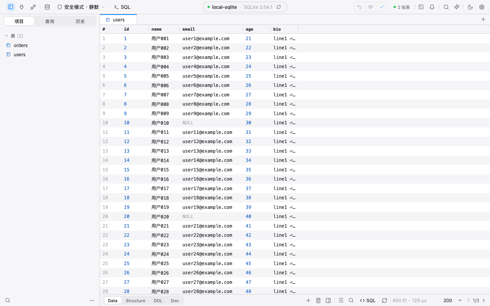
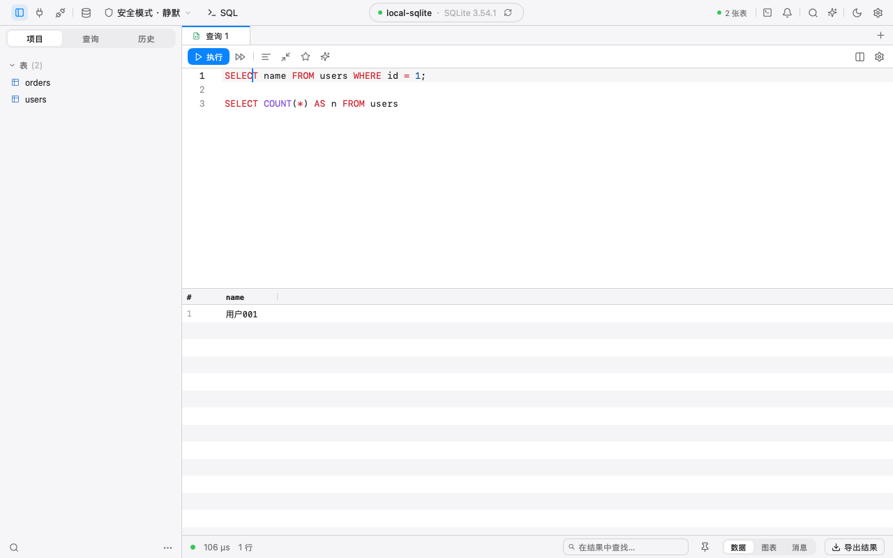
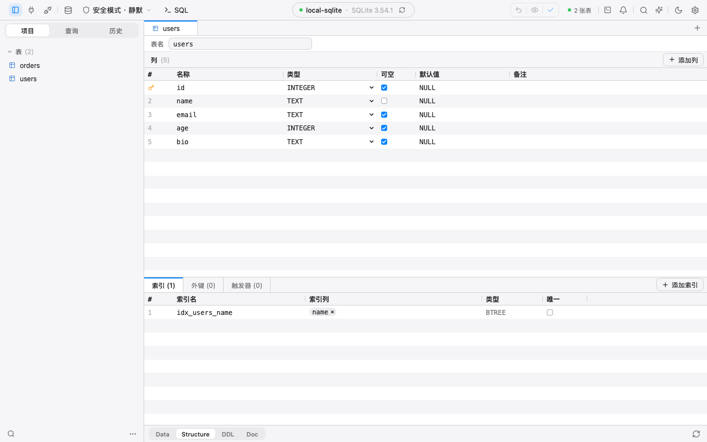
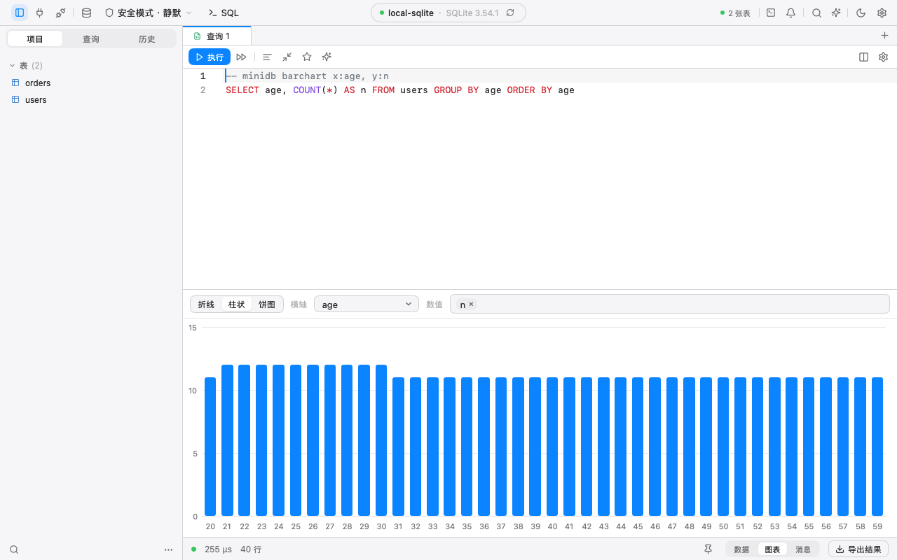
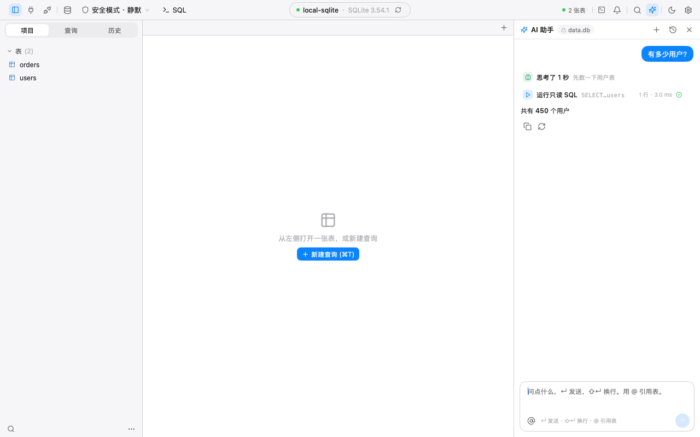
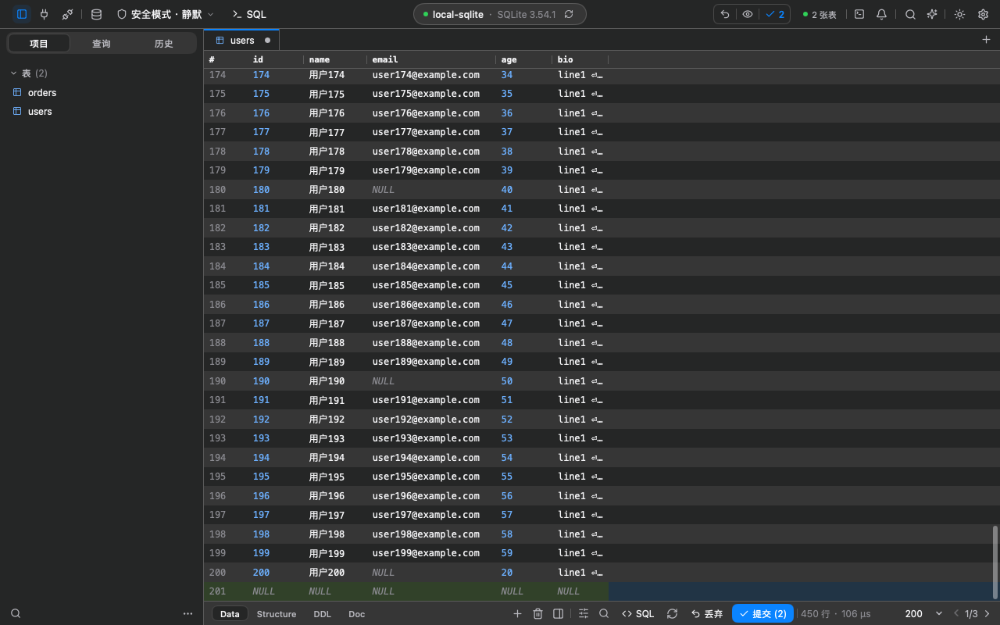

# MiniDB

MiniDB 是一款 AI 增强的桌面数据库客户端，用 Go 和 [MyGo](https://mygo.run/) 原生 UI 编写：没有 webview，没有前端工程，一个小体积的二进制。界面沿用 TablePlus 式的紧凑 macOS 风格。

**语言：** 简体中文 | [English](README.md)



## 截图

以下截图使用演示数据，界面同时提供中文和英文。

| | |
| --- | --- |
| <br>**SQL 编辑器**：语法高亮、补全、多结果集 | <br>**表结构**：列、索引、外键、触发器集中在一个视图 |
| <br>**图表**：查询结果一键切换为折线 / 柱状 / 饼图 | <br>**AI 助手**：工具调用时间线与只读查询 |
| <br>**深色模式**：未提交的修改会高亮，提交前一目了然 | |

## 功能

- **连接管理**：MySQL、MariaDB、PostgreSQL、SQL Server、ClickHouse、SQLite、TiDB、StarRocks；SSH 隧道、只读模式、环境标签与颜色（强调色跟随当前连接）、加密备份与导入。
- **浏览与编辑**：库表侧边栏、分页数据网格、服务端排序与筛选（列条件或原始 SQL）、单元格块选并复制为 TSV / CSV / JSON / SQL INSERT / Markdown；双击编辑、新增、删除，提交前预览将要执行的 SQL，同一事务提交。网格按表记住列宽、列序、隐藏与固定的列；⌘L 按列名模糊跳转；JSON 值可切成树视图；BLOB 以十六进制查看，可直接编辑或从文件载入。
- **ER 图**：把一个库的表和外键画成关系图，分层布局、平移缩放、拖动调整并记住位置；大库默认只显示选中的表和它周围几层。
- **SQL 编辑器**：语法高亮、表/列/别名补全、多语句执行（当前语句 / 选中 / 全部）、可取消、多结果集以标签页排开、格式化（作用于选中或光标所在语句，缩进与关键字大小写可设）、历史与收藏（⌘D）；结果集还可以切换为折线 / 柱状 / 饼图。**行内 AI**（⌘J）直接在编辑器里写或改写 SQL。**执行计划**（⌥⌘E）把光标所在的语句解释成一棵树（PostgreSQL、MySQL、TiDB、SQLite；StarRocks 显示原文），可选 ANALYZE（真实执行只读 SELECT）并高亮最费时的一步。
- **表结构**：参考 TablePlus 的网格：列就地编辑（MySQL 系可上下拖动行调整列序），分隔条下方是索引 / 外键 / 触发器，分隔条可拖动；添加索引直接在表格里新增一行填写，不弹窗；提交前预览 DDL。另有 DDL 查看、Markdown 表文档（可由 AI 生成）。
- **AI 助手**：内置服务商预设（OpenAI、DeepSeek、OpenRouter、Ollama、Gemini、Anthropic 原生接口），也可接任意兼容 OpenAI 的接口，支持自定义请求头和生成参数；流式回答，工具调用时间线（查表结构、样例数据、只读 SQL、执行计划…），结构化结果直接以表格显示；输入 `@` 可提及表（以标签显示，并在提示词里着重说明）；护栏只允许单条只读 SQL；会话持久化。
- **导入导出**：CSV / JSON / SQL INSERT 流式导出，CSV / TSV / JSON 导入并映射列，进度与取消。
- **其他**：命令面板（⌘P）、数据库切换（⌘K）、监控窗口（实时指标、慢查询、进程列表，⌥⌘M）、连接文件夹分组、中英双语、浅色/深色、会话恢复（标签页与查询草稿）、自动更新。

支持 macOS 12 及以上（Apple Silicon 与 Intel）。

## 开发

需要 Go 1.27+，不需要 Node、pnpm 或 cgo。

```bash
go tool mygo dev            # 开发模式，Go 文件变化自动重建重启
go test ./...               # 测试（界面用 ui.Tester 无窗口运行）
go tool mygo build          # 打包 build/darwin-<arch>/MiniDB.app 和 .dmg
```

`docs/screenshots/` 里的截图来自无窗口的界面测试：运行 `MINIDB_SHOTS=<目录> go test ./internal/ui/`，会把所有界面渲染成 PNG 写入该目录。

修改 `locales/*.json` 后运行 `go tool mygo generate` 重新生成消息函数，`go tool mygo i18n check` 检查两种语言是否一致。

### 代码结构

```text
main.go            启动：日志、单实例、存储、装配
mygo.json          应用配置（名称、标识、版本、i18n、macOS 设置）
locales/           zh-Hans.json、en.json 与生成的 catalog_gen.go
internal/
  database/ agent/ ai/ schemaindex/ sshtunnel/ dataimport/ export/   领域层，不依赖 UI
  sqltext/         SQL 拆分、格式化、补全
  storage/         SQLite 存储、加密、旧 BoltDB 数据导入
  keychain/        从系统钥匙串取本地加密密钥
  app/             应用层：连接、查询、导入导出、AI、历史…（不依赖 UI）
  ui/              界面层：只读写状态、调用应用层
docs/              INSTALL.md（面向用户）、UI_GUIDE.md（视觉与交互规范）
scripts/           gen_icon.py（生成应用图标）、version/（给 CI 打印版本号）
```

依赖方向固定为 `ui → app → 领域层`。视图函数每帧都会执行，所以**不做 I/O**：阻塞操作放进 `uiThread.bg`，结果再回到 UI 线程。

## 数据与安全

| 内容 | 位置 |
| --- | --- |
| 应用数据 | `~/Library/Application Support/MiniDB/minidb.sqlite` |
| 日志 | `~/Library/Application Support/MiniDB/logs/` |
| 本地加密密钥 | 登录钥匙串（无钥匙串时回退为数据目录里的 `secret.key`） |

- 数据库密码、AI 密钥、SSH 口令落库前用 AES-GCM 加密。
- 首次启动会自动导入旧版（Wails 版）数据 `~/.minidb`，旧目录原样保留。
- AI 自动执行只允许单条只读 SQL，拒绝写入、多语句和 `EXPLAIN ANALYZE` 等风险语句；写操作只能由用户在预览确认后执行。
- AI 服务商会收到表结构上下文和你发送的内容，请勿向不可信的服务商发送敏感业务数据。

环境变量 `MINIDB_NO_KEYCHAIN=1` 让密钥保存在文件里，用于测试和无头环境。

## 快捷键

| 快捷键 | 功能 |
| --- | --- |
| `⌘N` / `⌘T` / `⌘W` | 新建连接 / 新建查询 / 关闭标签页 |
| `⌘P` / `⌘K` / `⌘I` | 命令面板 / 切换数据库 / AI 助手 |
| `⌘↵` / `⇧⌘↵` | 执行当前语句或选中内容 / 执行全部 |
| `⇧⌘F` | 格式化 SQL（编辑器内） |
| `⌘Y` | 查询历史 |
| `⌘J` / `⌘D` | 行内 AI / 收藏当前查询（编辑器内） |
| `⌥⌘E` | 执行计划（编辑器内） |
| `⌘S` / `⇧⌘P` / `⇧⌘⌫` | 提交 / 预览 SQL / 丢弃未提交的修改 |
| `⌘R` | 刷新 |
| `⌘,` | 设置 |

以上都可以在 设置 → 快捷键 里重新绑定。

## 发布

发版在本机完成：改好 `mygo.json` 的版本和 `CHANGELOG.md` 后提交，运行 `scripts/release.sh`——跑测试、本地构建并签名 macOS universal 包、上传到 GitHub Release、打标签并发布，不依赖线上 CI 构建。没有 Developer ID 时为 ad-hoc 签名，用户首次打开需右键 → 打开。

自动更新需要先 `go tool mygo keygen` 生成密钥，把公钥写入 `mygo.json` 的 `updates`，私钥放进仓库 secret `MYGO_UPDATER_PRIVATE_KEY`。

## 许可证

[MIT](LICENSE)
